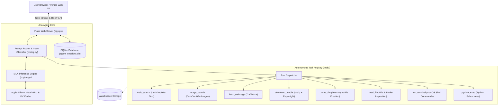

# Aria // Venice Agent Workspace

<div align="center">


**A high-performance autonomous AI agent workspace running 100% locally on Apple Silicon.**  
Featuring real-time Server-Sent Events (SSE) token streaming, multi-step autonomous tool chaining, prompt KV cache reuse, universal media sniffing/downloading, and an interactive dark UI.

[Quickstart](#quickstart-run-in-3-steps) • [Architecture](#system-architecture) • [Agent Tools](#built-in-agent-tools) • [Model Setup](#model-configuration) • [Configuration](#configuration--environment-variables) • [Troubleshooting](#troubleshooting)

</div>

---

## Highlights

- **100% Private, Local Inference**: Runs locally on macOS Apple Silicon using Apple's [MLX](https://github.com/ml-explore/mlx) framework with native Metal GPU acceleration.
- **Venice Dark Web UI**: Minimalist, high-contrast dark interface featuring:
  - Real-time token streaming with live generation speed telemetry (`tok/s`).
  - Active Unified Memory (RAM) monitoring.
  - Interactive collapsible `<think>` reasoning drawer that automatically expands during planning and collapses when the response begins.
  - Telemetry drawer tracking execution steps and tool observations.
  - Inline image gallery cards with direct viewing and thumbnail fallbacks.
- **Autonomous Multi-Step Tool Chaining**: Aria autonomously decides when to search the web, scrape articles, create folders, write code, run shell commands, or download media in a single execution loop.
- **Prompt KV Cache Delta Acceleration**: Maintains prompt KV cache state between turns to reuse prefill tokens and dramatically accelerate multi-turn conversation response latency.
- **Universal Media Sniffing & Downloader**: Combines `yt-dlp` with a headless Playwright Chromium stream interceptor to discover, sniff, and download HLS streams (`.m3u8`), `.mp4` video files, Instagram Reels, and YouTube videos directly to your workspace.
- **Local Workspace Sandboxing**: Dedicated `./Workspace` folder where all generated files, scripts, and downloads reside.
- **Persistent SQLite History**: Full session management with automatic naming, token metrics, step traces, and message persistence.

---

## System Architecture



---

## Hardware & System Requirements

| Component | Minimum Requirement | Recommended |
| :--- | :--- | :--- |
| **Operating System** | macOS 13.5 (Ventura) or newer | macOS 14 (Sonoma) or macOS 15 (Sequoia) |
| **Processor** | Apple Silicon M1 (arm64) | Apple Silicon M2 / M3 / M4 (Pro, Max, Ultra) |
| **Unified Memory (RAM)** | 8 GB (for 3B–7B models) | 16 GB – 36 GB+ (for 9B–14B+ models) |
| **Python** | Python 3.10 – 3.13 | Python 3.12 or 3.13 |
| **Media Tools** | `ffmpeg` (optional, for audio conversion) | Installed via Homebrew (`brew install ffmpeg`) |

---

## Quickstart (Run in 3 Steps)

### 1. Clone the repository
```bash
git clone https://github.com/your-username/aria-venice-agent.git
cd aria-venice-agent
```

### 2. Run the automated setup
The setup script validates your Apple Silicon environment, creates a `.venv`, installs all Python dependencies, installs Playwright Chromium for media sniffing, and configures `.env`:
```bash
./setup.sh
```

### 3. Launch the agent
```bash
./run.sh
```

Open your browser and navigate to:
```
http://127.0.0.1:5050
```

---

## Manual Installation

If you prefer to configure the environment step-by-step:

```bash
# 1. Create a virtual environment
python3 -m venv .venv
source .venv/bin/activate

# 2. Upgrade pip and install requirements
pip install --upgrade pip
pip install -r requirements.txt

# 3. Install Playwright Chromium (for dynamic video sniffing)
playwright install chromium

# 4. (Optional) Install ffmpeg for media conversions
brew install ffmpeg

# 5. Initialize configuration and workspace
cp .env.example .env
mkdir -p Workspace
touch Workspace/.gitkeep

# 6. Start the server
python app.py
```

---

## Model Configuration

Aria uses **Apple MLX** (`mlx-lm`) for local model execution. You can load models in two ways:

### Option A: Automatic Hugging Face Hub Download (Recommended)
Set `MODEL_PATH` in your `.env` or in the Web UI left sidebar to any compatible MLX quantized model on Hugging Face:
```env
MODEL_PATH=mlx-community/Qwen2.5-7B-Instruct-4bit
```
*When first run, `mlx-lm` will automatically download and cache the model from Hugging Face into `~/.cache/huggingface/hub/`.*

Popular recommended MLX models:
- `mlx-community/Qwen2.5-7B-Instruct-4bit` (Fast, great reasoning, ~4.5 GB RAM)
- `mlx-community/Qwen2.5-Coder-7B-Instruct-4bit` (Optimized for coding & shell tasks)
- `mlx-community/Qwen2.5-14B-Instruct-4bit` (Deeper reasoning for 24 GB+ RAM Macs)
- `mlx-community/Llama-3.2-3B-Instruct-4bit` (Ultra-lightweight for 8 GB RAM Macs)

### Option B: Local Offline Weights
If you already have a local 4-bit quantized MLX model folder (e.g., `Huihui-Qwen3.5-9B-MLX` or `./model` containing `config.json` and `.safetensors` files):
```env
MODEL_PATH=../Huihui-Qwen3.5-9B-MLX/model
# or
MODEL_PATH=./model
```
Aria automatically checks sibling directories, parent directories, and `~/Desktop` for the model folder.

### Changing Models at Runtime
You can also change the model path on the fly via the Web UI:
1. Open the left drawer (**Menu** button).
2. Switch to the **Persona & Limits** tab.
3. Enter the local path or Hugging Face repo ID in the **Model Path** input.
4. Send your message—the engine dynamically clears the previous weights and loads the new model.

---

## Configuration & Environment Variables

Copy `.env.example` to `.env` to customize settings:

```bash
cp .env.example .env
```

| Variable | Default Value | Description |
| :--- | :--- | :--- |
| `HOST` | `127.0.0.1` | Local IP address for the Flask server. |
| `PORT` | `5050` | Port for the web interface. |
| `MODEL_PATH` | `mlx-community/Qwen2.5-7B-Instruct-4bit` | Local path or Hugging Face Hub ID for the MLX model. |
| `WORKSPACE_DIR` | `./Workspace` | Working directory where generated files and downloads are stored. |
| `DB_PATH` | `./agent_sessions.db` | Path to the SQLite chat and session database. |
| `DEFAULT_PERSONA` | *(Aria's persona)* | System persona instructions provided to the model. |

---

## Built-in Agent Tools

Aria comes equipped with 8 autonomous tools registered in `tools/`:

| Tool Name | Capability | Example Action |
| :--- | :--- | :--- |
| `web_search` | Real-time DuckDuckGo web search for facts, news, and documentation. | `{"tool": "web_search", "query": "Python 3.13 features"}` |
| `image_search` | DuckDuckGo image search rendered directly as interactive cards. | `{"tool": "image_search", "query": "Cyberpunk city wallpaper", "count": 3}` |
| `fetch_webpage` | Extracts readable article and text content from a web URL using Trafilatura. | `{"tool": "fetch_webpage", "url": "https://example.com/article"}` |
| `download_media` | Universal video/audio downloader (`yt-dlp` + headless Playwright stream sniffer). | `{"tool": "download_media", "urls": ["https://..."], "mode": "video"}` |
| `write_file` | Creates directories and writes text/code files to `./Workspace`. | `{"tool": "write_file", "path": "notes/summary.md", "content": "..."}` |
| `read_file` | Reads file content or lists folder contents in `./Workspace`. | `{"tool": "read_file", "path": "notes"}` |
| `run_terminal` | Executes macOS shell commands (`ls`, `rm`, `git`, `cat`, etc.) in `./Workspace`. | `{"tool": "run_terminal", "command": "ls -lh"}` |
| `python_exec` | Executes Python code in a subprocess for calculations and data processing. | `{"tool": "python_exec", "code": "print(2**32)"}` |

---

## Example Prompts to Try

- **Multi-Tool Autonomous Chaining**:
  > *"Search for the latest release notes of Python 3.13, create a folder named `python_guide` in my workspace, and write a detailed markdown file inside it summarizing the changes."*

- **Visual Gallery**:
  > *"Show me pictures of Mount Fuji in winter."*

- **Universal Media Downloading**:
  > *"Download this video to my workspace: https://www.youtube.com/watch?v=..."*

- **File Inspection & Terminal Management**:
  > *"List all the files inside my Workspace and show me what's inside the largest one."*

- **Direct Conversational Banter**:
  > *"Hey Aria, what kind of trouble can we get into today?"*

---

## Project Structure

```
aria-venice-agent/
├── app.py                  # Flask web server, SSE event streaming, & agent execution loop
├── config.py               # Prompt routing, keyword triggers, persona, & environment loader
├── database.py             # SQLite session storage, message persistence, & telemetry
├── engine.py               # Apple Silicon MLX engine, model loader, & prompt cache manager
├── templates/
│   └── index.html          # Venice dark UI, markdown rendering, & SSE streaming client
├── tools/
│   ├── __init__.py         # Dynamic tool registry & schema formatter
│   ├── system_tools.py     # File reading, writing, terminal execution, & Python exec
│   ├── web_tools.py        # Web search, article scraping, & image gallery search
│   └── media_tools.py      # Video downloader & Playwright network stream sniffer
├── Workspace/              # Agent workspace where files and downloads are stored
│   └── .gitkeep
├── setup.sh                # Automated one-step setup script (venv, pip, playwright, env)
├── run.sh                  # Launch script
├── requirements.txt        # Python dependency specification
├── pyproject.toml          # Modern PEP 621 project configuration
├── .env.example            # Environment variable template
├── .gitignore              # Git ignore rules (caches, DB, models, downloads)
├── LICENSE                 # MIT License
└── README.md               # Complete project documentation
```

---

## Troubleshooting

### 1. `MLX model folder not found locally`
- **Solution**: Ensure your path in `.env` is correct. If using an offline folder, make sure it contains `config.json` and `.safetensors`. Alternatively, provide a Hugging Face repo ID such as `mlx-community/Qwen2.5-7B-Instruct-4bit` to let the engine download it automatically.

### 2. Playwright Chromium browser missing
- **Symptom**: `playwright._impl._errors.Error: Executable doesn't exist...`
- **Solution**: Run:
  ```bash
  playwright install chromium
  ```

### 3. Port `5050` already in use
- **Solution**: Change `PORT` in your `.env` file:
  ```env
  PORT=5051
  ```
  Or launch with:
  ```bash
  PORT=5051 ./run.sh
  ```

### 4. Audio conversion failed in `download_media`
- **Symptom**: `yt-dlp: FFmpegExtractAudio: ffmpeg not found`
- **Solution**: Install `ffmpeg` using Homebrew:
  ```bash
  brew install ffmpeg
  ```

### 5. High Unified Memory Usage
- **Solution**: Click **Persona & Limits** in the UI menu and adjust:
  - Reduce **Action Token Limit** (e.g., 1024).
  - Reduce **Final Response Token Limit** (e.g., 2048).
  - Use a smaller model like `mlx-community/Llama-3.2-3B-Instruct-4bit` or `mlx-community/Qwen2.5-7B-Instruct-4bit`.

---

## License

This project is licensed under the [MIT License](LICENSE).

